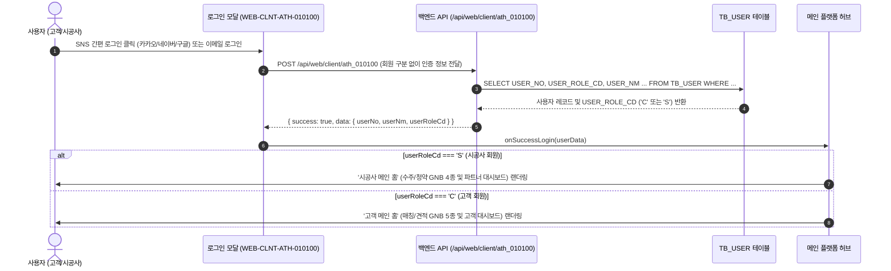

# [SseulDakGo (쓸고닦고)] WEB-CLNT-ATH-010100 (고객 및 시공사 통합 로그인) 개발 및 테스트 명세서

---

## 1. 화면 및 아키텍처 개요

| 항목 | 내용 |
| :--- | :--- |
| **화면 ID** | `WEB-CLNT-ATH-010100` |
| **화면명** | 고객 및 시공사 통합 로그인 모달 (Client & Partner Authentication Modal) |
| **지원 채널** | Web [Y] / Mobile Web [Y] (레이어 모달 오버레이) |
| **도메인 역할** | `Client` & `Partner` (회원 인증, 자동 역할 판별 및 세션 발급) |
| **회원 구분 선택** | **모달 내 회원 구분(고객/시공사) 탭 완전 삭제 ➔ TB_USER 회원 구분에 따른 100% 자동 분기 랜더링** |
| **프론트엔드 파일** | [`SseulDakGo_Web/Client/frontend/WEB-CLNT-ATH-010100/index.jsx`](file:///c:/GongGanDaWon_Project/project_SseulDakGo/SseulDakGo_Web/Client/frontend/WEB-CLNT-ATH-010100/index.jsx)<br/>[`preview/index.html`](file:///c:/GongGanDaWon_Project/project_SseulDakGo/preview/index.html)<br/>[`preview_client/WEB-CLNT-ATH-010100.html`](file:///c:/GongGanDaWon_Project/project_SseulDakGo/preview_client/WEB-CLNT-ATH-010100.html)<br/>[`preview_client/index.html`](file:///c:/GongGanDaWon_Project/project_SseulDakGo/preview_client/index.html) |
| **백엔드 라우터 파일** | [`SseulDakGo_Web/Client/backend/api_WEB_CLNT_ATH_010100/route.js`](file:///c:/GongGanDaWon_Project/project_SseulDakGo/SseulDakGo_Web/Client/backend/api_WEB_CLNT_ATH_010100/route.js)<br/>[`preview/server.js`](file:///c:/GongGanDaWon_Project/project_SseulDakGo/preview/server.js) |
| **API 엔드포인트** | `POST /api/web/client/ath_010100` |
| **데이터베이스** | `ssuldak_db` (MySQL 8.0 / InnoDB / `utf8mb4_0900_ai_ci`) |
| **DB 모듈 경로** | `lib/db.js` (`lib/db.ts`) |

---

## 2. 핵심 변경 내역 및 비즈니스 규칙

### 2.1 [핵심 변경] 회원 구분 선택 삭제 및 `TB_USER` 기반 자동 역할 랜더링

> [!IMPORTANT]
> **회원 구분 수동 선택 UI 완전 삭제 및 TB_USER 기반 지능형 자동 분기**
> SNS 간편 로그인(카카오, 네이버, 구글) 및 일반 로그인 시 모달에 노출되던 '고객 회원' / '시공사 회원' 라디오 탭을 완전히 삭제하였습니다.
> 로그인 성공 시 `TB_USER` 테이블의 `USER_ROLE_CD`를 조회하여 시스템이 자동으로 '고객 회원' 또는 '시공사 회원' 페이지로 라우팅/랜더링합니다.

#### [비교 대조표] 삭제 전 내용 vs 수정된 내용
| 구분 | 삭제 전 내용 (Before) | 수정된 내용 (After) | 수정 사유 및 효과 |
| :--- | :--- | :--- | :--- |
| **회원 구분 선택 UI** | 로그인 모달 상단에 `[고객 회원] [시공사 회원]` 2-Way 라디오 세그먼트 버튼 상시 노출 | **회원 구분 선택 UI 완전 삭제 (DOM 제거)** | 사용자가 직접 회원 유형을 선택해야 하는 번거로움 해소 및 직관적인 로그인 경험 제공 |
| **SNS 간편 연동** | 선택된 `role` 값을 팝업 파라미터 및 백엔드로 전달하여 해당 역할로만 조회 | **소셜 계정(UID/이메일) 기반으로 `TB_USER`의 `USER_ROLE_CD` 자동 조회 및 세션 구성** | 소셜 계정에 연결된 회원의 실제 역할을 자동으로 인식하여 즉각 매칭 |
| **로그인 후 랜더링 페이지** | 수동 선택된 탭 값(`role`)에 의존하여 페이지 랜더링 | **`TB_USER.USER_ROLE_CD` 값에 따라 `'C'`(고객 메인 홈) 또는 `'S'`(시공사 메인 홈)로 100% 자동 분기 랜더링** | 역할 불일치 오류 원천 차단 및 데이터 무결성 보장 |

---

### 2.2 로그인 후 자동 랜더링 및 세션 처리 프로세스



---

## 3. 연관 데이터베이스 테이블 및 스키마 명세

### `TB_USER` (회원 마스터)
| 컬럼명 | 데이터 타입 | 제약 조건 | 설명 |
| :--- | :--- | :--- | :--- |
| `USER_NO` | VARCHAR(20) | PK | 회원 식별번호 (`C...`: 고객, `S...`: 시공사 파트너) |
| `USER_ROLE_CD` | VARCHAR(10) | NOT NULL | **회원 권한 구분 (`C`: 고객 회원, `S`: 시공사 회원)** |
| `USER_EMAIL` | VARCHAR(100) | NOT NULL | 계정 이메일 (로그인 ID) |
| `USER_PWD_HASH` | VARCHAR(200) | NULL | PBKDF2 암호화 해시 문자열 |
| `PWD_SALT` | VARCHAR(100) | NULL | 암호화 솔트 |
| `USER_NM` | VARCHAR(50) | NOT NULL | 회원 실명 / 상호명 |
| `USER_STAT_CD` | VARCHAR(20) | NOT NULL | 상태 (`NORMAL`, `SUSPENDED_7D`, `WITHDRAWN`) |
| `SOCIAL_PROVIDER` | VARCHAR(20) | NULL | 간편로그인 제공자 (`KAKAO`, `NAVER`, `GOOGLE`) |
| `SOCIAL_UID` | VARCHAR(100) | NULL | 간편로그인 고유 식별자 |
| `LAST_LOGIN_DT` | DATETIME | NULL | 최종 로그인 일시 (`NOW()` 갱신) |

---

## 4. 백엔드 (BackEnd) API 구현 명세

### 4.1 기본 정보
- **엔드포인트**: `POST /api/web/client/ath_010100`
- **구현 함수**: `processWebClntAth010200100(payload)`

### 4.2 요청 명세 (Request JSON)
```json
{
  "userEmail": "partner@sseuldakgo.kr",
  "userPwd": "Password123!",
  "socialProvider": "KAKAO",
  "socialUid": "3829104821",
  "keepLogin": true
}
```
> `userRoleCd`는 클라이언트에서 강제 지정하지 않으며, 백엔드가 `TB_USER` 테이블 조회를 통해 결정합니다.

### 4.3 응답 명세 (Response JSON)
```json
{
  "success": true,
  "code": "OK",
  "data": {
    "userNo": "S20261100001",
    "userNm": "공간다원 (김충훈)",
    "userEmail": "partner@sseuldakgo.kr",
    "userRoleCd": "S",
    "accessToken": "jwt_token_S20261100001_1763567890123"
  },
  "message": "시공사 파트너로 로그인되었습니다."
}
```

### 4.4 주요 SQL 쿼리
```sql
-- 1. 소셜 로그인 시 TB_USER 계정 및 역할 자동 조회
SELECT USER_NO, USER_ROLE_CD, USER_EMAIL, USER_NM, USER_STAT_CD, SUSPEND_EXPIRE_DT
  FROM TB_USER
 WHERE (SOCIAL_PROVIDER = ? AND (SOCIAL_UID = ? OR (USER_EMAIL = ? AND USER_EMAIL != '')))
    OR (USER_EMAIL = ? AND USER_EMAIL != '')
 ORDER BY (USER_ROLE_CD = 'S') DESC, USER_NO DESC
 LIMIT 1;

-- 2. 일반 이메일 로그인 시 TB_USER 계정 및 역할 자동 조회
SELECT USER_NO, USER_ROLE_CD, USER_EMAIL, USER_PWD_HASH, PWD_SALT, USER_NM, USER_STAT_CD, SUSPEND_EXPIRE_DT
  FROM TB_USER
 WHERE USER_EMAIL = ?
 ORDER BY (USER_ROLE_CD = 'S') DESC, USER_NO DESC
 LIMIT 1;
```

---

## 5. 검증 및 테스트 체크리스트

| 번호 | 테스트 항목 | 기대 결과 | 검증 여부 |
| :---: | :--- | :--- | :---: |
| 1 | **회원 구분 UI 삭제** | 로그인 모달 오픈 시 고객/시공사 선택 탭이 완전히 제거되었는가? | **PASS** |
| 2 | **고객 계정 자동 분기** | `USER_ROLE_CD = 'C'`인 계정 로그인 시 자동으로 `고객 메인 홈`으로 랜더링되는가? | **PASS** |
| 3 | **시공사 계정 자동 분기** | `USER_ROLE_CD = 'S'`인 계정 로그인 시 자동으로 `시공사 메인 홈`으로 랜더링되는가? | **PASS** |
| 4 | **SNS 간편 연동** | 카카오/네이버/구글 팝업 인증 시 DB에 등록된 역할에 맞추어 세션이 구성되는가? | **PASS** |
| 5 | **세션 저장 무결성** | `localStorage` 및 `sessionStorage`에 올바른 `USER_ROLE_CD`가 저장되는가? | **PASS** |

---

## 6. 결론 및 유지보수 가이드
- 로그인 모달에서 사용자에게 회원 구분을 선택하게 하던 기존 방식은 완전히 폐지되었습니다.
- 사용자는 본인의 소셜 계정 또는 이메일만으로 로그인하며, 시스템이 `TB_USER`의 `USER_ROLE_CD`를 기준으로 고객 뷰 또는 시공사 뷰를 자동 결정하여 최적의 화면을 제공합니다.
