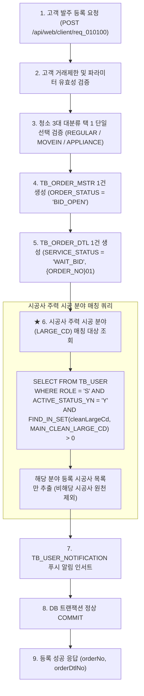

# [SseulDakGo (쓸고닦고)] WEB-CLNT-REQ-010100 (청소 서비스 신청 - 발주서 작성) 개발 및 테스트 명세서

---

## 1. 화면 및 아키텍처 개요

| 항목 | 내용 |
| :--- | :--- |
| **화면 ID** | `WEB-CLNT-REQ-010100` |
| **화면 구분** | `Sub (모달)` |
| **화면명** | 청소 서비스 신청 및 발주서 작성 (Cleaning Service Request Modal) |
| **지원 채널** | Web [Y] / Mobile Web [Y] (반응형 모달 / 풀스크린 뷰) |
| **도메인 역할** | `Client` (고객 전용 청소 발주서 등록) |
| **프론트엔드 파일** | [`SseulDakGo_Web/Client/frontend/WEB-CLNT-REQ-010100/index.jsx`](file:///c:/GongGanDaWon_Project/project_SseulDakGo/SseulDakGo_Web/Client/frontend/WEB-CLNT-REQ-010100/index.jsx) |
| **백엔드 라우터 파일** | [`SseulDakGo_Web/Client/backend/api_WEB_CLNT_REQ_010100/route.js`](file:///c:/GongGanDaWon_Project/project_SseulDakGo/SseulDakGo_Web/Client/backend/api_WEB_CLNT_REQ_010100/route.js)<br/>[`SseulDakGo_App/Client/backend/api_APP_CLNT_REQ_010100/route.js`](file:///c:/GongGanDaWon_Project/project_SseulDakGo/SseulDakGo_App/Client/backend/api_APP_CLNT_REQ_010100/route.js) |
| **API 엔드포인트** | `POST /api/web/client/req_010100` (Web)<br/>`POST /api/app/client/req_010100` (App) |
| **데이터베이스** | `ssuldak_db` (MySQL 8.0 / InnoDB / `utf8mb4_0900_ai_ci`) |
| **DB 모듈 경로** | `lib/db.js` (`lib/db.ts`) |

### 핵심 아키텍처 준수 규칙 및 비즈니스 룰

1. **3개 청소 유형 중 단 1개만 단일 선택 (택 1 원칙)**:
   - 고객은 발주서 작성 시 **"정기청소(`REGULAR`)", "입주이사청소(`MOVEIN`)", "계절가전청소(`APPLIANCE`)"** 3대 분류 중 **반드시 1개만 선택**하여 신청할 수 있습니다.
   - 복수 청소 유형 동시 선택 기능은 UI/백엔드에서 원천 차단되며, 타 유형의 시공이 필요할 경우 별도의 발주서를 독립 등록해야 합니다.

2. **★ [핵심] 시공사 주력 시공 분야(`LARGE_CD`) 타겟팅 푸시 발송 정책**:
   - 이용자가 청소 요청(발주 등록)을 완료했을 때, 파트너 시공사에게 발송되는 실시간 푸시 알림(`TB_USER_NOTIFICATION`)은 **해당 청소 용역 분야로 등록된 시공사에게만 한정하여 전달**합니다.
   - **매칭 기준**:
     - 시공사가 사업자등록증 및 자격/경력 관리(`WEB-CLNT-MYP-020100`) 화면에서 등록한 **`주력 시공 분야 (LARGE_CD)`** (`TB_USER.MAIN_CLEAN_LARGE_CD`).
     - 고객이 선택한 청소 대분류(`cleanLargeCd`: `REGULAR`, `MOVEIN`, `APPLIANCE`)가 시공사의 `MAIN_CLEAN_LARGE_CD`에 포함된 시공사만 백엔드 SQL 조건절(`FIND_IN_SET` / `LIKE`)로 필터링하여 푸시 메시지를 인서트 및 발송합니다.
     - **예시 동작**:
       - 고객이 **"입주청소"**를 발주하면 ➔ 주력 분야에 `입주청소`가 등록된 시공사(예: 공간다원)에게만 푸시 발송 (O).
       - 고객이 **"계절가전청소"**를 발주하면 ➔ 주력 분야에 `계절가전청소`가 없는 시공사는 제외되고, `계절가전청소` 전문 등록 시공사에게만 푸시 발송 (X 차단).
     - 이를 통해 무분별한 전체 시공사 대상 스팸성 알림을 방지하고, 적합한 전문 시공사의 신속한 청약 참여를 유도합니다.

3. **발주 상세(DTL) 1건 단일 생성 체계**:
   - 주발주(`TB_ORDER_MSTR`) 1건당 상세 품목(`TB_ORDER_DTL`)은 오직 **1건(`{ORDER_NO}01`, 18자리)**만 원자적으로 생성됩니다.
   $$\mathbf{ORDER\_DTL\_NO} = \mathbf{ORDER\_NO(16자리)} + \mathbf{"01"}$$

4. **청소 희망 일자 및 시작 시각 필수 입력 체계 (스케줄 중복 청약 방지)**:
   - 고객은 반드시 **청소 희망 일자(`HOPE_CLEAN_DATE`)**와 **청소 시작 희망 시각(`HOPE_CLEAN_TIME`, HH:mm 포맷 예: 14:00)**을 필수로 지정해야 합니다.
   - 이 데이터는 3단계 시공사 청약 시 **시공사의 기 체결 계약 및 타 일감과의 스케줄 겹침(충돌)을 원천 차단(`ERR_SCHEDULE_CONFLICT`)**하는 판별 기준이 됩니다.

5. **고객 거래제한(선취소 제재) 사전 검증**:
   - 발주 등록 시점 고객의 이용 정지 상태(`TB_USER.USER_STAT_CD = 'SUSPENDED_8D'` 또는 `PERMANENT_BLOCKED`), 제재 만료일(`SUSPEND_EXPIRE_DT >= NOW()`)을 검증하여 거래제한 중인 고객의 신규 발주 등록을 원천 차단(`ERR_CLIENT_RESTRICTED`, HTTP 403)합니다.

6. **정기청소 최소 3개월(90일) 의무 락 규칙**:
   - 정기청소(`REGULAR`) 선택 시: `(SERVICE_END_DT - SERVICE_START_DT) < 90일`인 경우 프론트엔드 버튼 비활성화 및 백엔드 `ERR_MIN_PERIOD_NOT_MET` (HTTP 400) 에러를 반환합니다.

7. **확정 지정 제안가 단일 등록 및 매칭 정보이용료**:
   - 고객이 직접 지불하고자 하는 100% 현장 직불 노무비(`PROPOSED_PRICE > 0`)를 단일 확정가로 입력합니다.
   - 4~5단계 시공사 최종 낙점 시 고객이 납부하는 데이터 매칭 이용료는 단일 건 기준 **16,500원(고정, VAT 포함)**이 부과됩니다.

8. **7일 청약 기한 설정**:
   - `BID_EXPIRE_DT`를 발주 등록일 기준 `NOW() + INTERVAL 7 DAY`로 자동 바인딩합니다.

---

## 2. 연관 데이터베이스 테이블 및 스키마 명세

### 2.1 `TB_ORDER_MSTR` (주발주 마스터)
| 컬럼명 | 데이터 타입 | 제약 조건 | 설명 |
| :--- | :--- | :--- | :--- |
| `ORDER_NO` | CHAR(16) | PK | 주발주 관리번호 (`ORD` + YYYYMMDD + 5자리 Seq) |
| `CLIENT_USER_NO` | CHAR(12) | NOT NULL, FK | 발주 고객 식별번호 (`TB_USER.USER_NO`) |
| `ORDER_STATUS` | VARCHAR(20) | NOT NULL DEFAULT 'BID_OPEN' | 발주 상태 (`BID_OPEN`, `CNTR_WAIT_FEE`, `CNTR_CONFIRMED`, `ORD_CANCEL` 등) |
| `CHANGE_CONTRACTOR_CNT` | INT | NOT NULL DEFAULT 0 | 시공사 변경 누적 횟수 (최대 3회 허용) |
| `ADDR_TEXT` | VARCHAR(200) | NOT NULL | 기본 현장 주소 (동/리 노출용 도로명·지번 주소) |
| `ADDR_DETAIL` | VARCHAR(200) | NULL | 상세 주소 (동, 호수, 층수 등) |
| `PROPOSED_PRICE` | INT | NOT NULL | 고객 확정 제안금액 (100% 현장 직불 정찰가) |
| `DETAIL_REQ_NOTE` | TEXT | NULL | 현장 세부 요청사항 및 전달 메모 |
| `ALLIANCE_CD` | VARCHAR(30) | NULL | 제휴사 코드 |
| `BID_EXPIRE_DT` | DATETIME | NOT NULL | 청약 공고 만료 일시 (`NOW() + INTERVAL 7 DAY`) |
| `REG_DT` / `MOD_DT` | DATETIME | NOT NULL | 등록 및 최종 수정 일시 |

### 2.2 `TB_ORDER_DTL` (발주 상세 - 단 1건 적재)
| 컬럼명 | 데이터 타입 | 제약 조건 | 설명 |
| :--- | :--- | :--- | :--- |
| `ORDER_DTL_NO` | CHAR(18) | PK | 발주 상세번호 (`{ORDER_NO}01`) |
| `ORDER_NO` | CHAR(16) | NOT NULL, FK | 주발주 관리번호 (`TB_ORDER_MSTR.ORDER_NO`) |
| `CLEAN_LARGE_CD` | VARCHAR(30) | NOT NULL | 청소 대분류 (**단일 선택**: `REGULAR`, `MOVEIN`, `APPLIANCE` 택1) |
| `CLEAN_MID_CD` | VARCHAR(30) | NOT NULL | 중분류 코드 (`VILLA_COMM`, `APT_MOVEIN`, `AIRCON_MULTI` 등) |
| `SERVICE_STATUS` | VARCHAR(20) | NOT NULL DEFAULT 'WAIT_BID' | 시공상태 (`WAIT_BID`, `APPR_WAIT_FEE`, `APPR_CONTRACT`, `BID_CANCEL` 등) |
| `HOPE_CLEAN_DATE` | DATE | NOT NULL | **고객 확정 요청 청소 일자** (시공사 스케줄 중복 검증 기준) |
| `HOPE_CLEAN_TIME` | CHAR(5) | NOT NULL | **고객 확정 요청 청소 시작 시각** (`HH:mm`, 예: `14:00`) |
| `ESTIMATED_DURATION_HOURS` | INT | NOT NULL DEFAULT 4 | 예상 소요 시간 (기본값 4시간) |
| `CONTRACT_TYPE_CD` | VARCHAR(20) | NOT NULL DEFAULT '1회성 단독 시공' | 계약 형태 |
| `CONTRACT_TERM_DAYS` | INT | NULL DEFAULT 90 | 정기청소 90일 락 일수 (정기청소 전용) |
| `WEEK_CLEAN_FREQ` | INT | NULL DEFAULT 1 | 주간 방문 횟수 (정기청소 전용: 1, 2, 3회 등) |
| `CLEAN_DAYS_CONFIG` | VARCHAR(50) | NULL | 방문 희망 요일 (정기청소 전용: 예 `매주 월, 수`) |
| `SUPPLY_PYEONG` | DECIMAL(5,1) | NULL | 실평수/공급평수 (입주이사청소 전용) |
| `APPLIANCE_TOTAL_CNT` | INT | NOT NULL DEFAULT 0 | 계절가전 의뢰 기기 총 대수 (가전청소 전용) |
| `REG_DT` / `MOD_DT` | DATETIME | NOT NULL | 등록 및 최종 수정 일시 |

### 2.3 `TB_USER` (시공사 마스터 및 주력 시공 분야 매칭 컬럼)
| 컬럼명 | 데이터 타입 | 설명 |
| :--- | :--- | :--- |
| `USER_NO` | VARCHAR(20) | 시공사 회원번호 (`S`로 시작) |
| `USER_ROLE_CD` | VARCHAR(10) | 역할 코드 (`S`: 시공사 파트너) |
| `USER_NM` / `COMPANY_NM` | VARCHAR(100) | 대표자명 / 상호명 |
| `ACTIVE_STATUS_YN` | CHAR(1) | 계정 활성화 상태 (`Y`/`N`) |
| **`MAIN_CLEAN_LARGE_CD`** | VARCHAR(100) | **★ 시공사의 주력 시공 분야 (LARGE_CD)**<br/>콤마 구분 저장 (예: `'REGULAR,MOVEIN'`, `'APPLIANCE'`) |

### 2.4 `TB_USER_NOTIFICATION` (시공사 타겟팅 푸시 알림 적재)
| 컬럼명 | 데이터 타입 | 설명 |
| :--- | :--- | :--- |
| `NOTI_ID` | VARCHAR(20) | 알림 고유 ID (`NT` + YYYYMMDD + 5자리) |
| `USER_NO` | VARCHAR(20) | 수신 시공사 회원번호 (`S...`) |
| `NOTI_TYPE` | VARCHAR(20) | 알림 유형 (`NEW_ORDER`) |
| `TITLE` | VARCHAR(100) | 알림 제목 (`[신규 청소 발주] 새로운 {cleanLargeNm} 요청이 접수되었습니다.`) |
| `CONTENT` | VARCHAR(500) | 알림 본문 (발주번호, 현장 주소, 고객 지정가) |
| `TARGET_URL` | VARCHAR(255) | 클릭 시 이동할 발주 상세 경로 (`/preview_client/WEB-CLNT-ORD-010100.html?orderNo=...`) |
| `IS_READ` | CHAR(1) | 읽음 여부 (`N`) |
| `REG_DT` | DATETIME | 알림 등록 일시 |

---

## 3. 프론트엔드 (FrontEnd) 구현 명세

### 3.1 화면 레이아웃 및 3대 분류 단일 선택
```
┌─────────────────────────────────────────────────────────────────────────────┐
│ [우리집 청소 요청 등록하기]                                           [ ✕ ] │
├─────────────────────────────────────────────────────────────────────────────┤
│ 1. 청소 유형 선택 (택 1 필수)                                               │
│    (●) 🏢 정기청소         (○) 🏠 입주/이사청소         (○) ❄️ 계절가전청소 │
│    ※ 3가지 유형 중 단 1가지만 선택하여 신청하실 수 있습니다.              │
├─────────────────────────────────────────────────────────────────────────────┤
│ 2. 시공 현장 주소                                                           │
│    [우편번호 검색]  [ 경기 고양시 일산동구 백석동 120-1                      ] │
│    [상세주소]      [ 백석 상가빌딩 1~2층                                     ] │
├─────────────────────────────────────────────────────────────────────────────┤
│ 3. 청소 희망 일자 및 시작 시각 (필수)                                       │
│    시공일자: [ 2026-11-20 ]          시작시각: [ 14:00 ] (예상소요: 4시간)  │
├─────────────────────────────────────────────────────────────────────────────┤
│ 4. 카테고리별 특화 스펙 입력                                                │
│    - 정기청소: 최소 90일 보장 의무 락 + 주간 방문 횟수/요일 지정             │
│    - 입주청소: 공급평수 입력 (예: 34평)                                      │
│    - 계절가전청소: 에어컨, 세탁기 등 기기별 수량 및 세부 품목 지정           │
├─────────────────────────────────────────────────────────────────────────────┤
│ 5. 확정 지정 제안가 (100% 현장 직불)                                        │
│    지정금액: [ 450,000 ] 원                                                 │
├─────────────────────────────────────────────────────────────────────────────┤
│ [ 취소 ]                                            [ + 청소 요청 등록 완료 ]│
└─────────────────────────────────────────────────────────────────────────────┘
```

---

## 4. 백엔드 (BackEnd) 트랜잭션 및 타겟팅 푸시 발송 로직

### 4.1 발주 등록 트랜잭션 흐름도


### 4.2 시공사 주력 시공 분야(LARGE_CD) 매칭 쿼리 구현 소스
```javascript
// [SseulDakGo_Web/Client/backend/api_WEB_CLNT_REQ_010100/route.js]
// 2-6. 회원가입된 시공사 중 해당 청소 용역 분야(LARGE_CD)로 등록된 시공사만 타겟팅하여 발주 푸시 알림 발송 및 기록
try {
  const [partners] = await connection.execute(
    `SELECT USER_NO, USER_NM, USER_TEL, USER_EMAIL, MAIN_CLEAN_LARGE_CD 
     FROM TB_USER 
     WHERE (USER_ROLE_CD IN ('S', 'PARTNER', 'CORP') OR USER_NO LIKE 'S%') 
       AND ACTIVE_STATUS_YN = 'Y'
       -- ★ 시공사 사업자등록 검증 시 등록된 '주력 시공 분야 (LARGE_CD)' 매칭 조건
       AND (
         MAIN_CLEAN_LARGE_CD IS NULL 
         OR FIND_IN_SET(?, MAIN_CLEAN_LARGE_CD) > 0 
         OR MAIN_CLEAN_LARGE_CD LIKE CONCAT('%', ?, '%')
         OR (
           (? = 'REGULAR' AND (MAIN_CLEAN_LARGE_CD LIKE '%정기%' OR MAIN_CLEAN_LARGE_CD LIKE '%REGULAR%')) OR
           (? = 'MOVEIN' AND (MAIN_CLEAN_LARGE_CD LIKE '%입주%' OR MAIN_CLEAN_LARGE_CD LIKE '%이사%' OR MAIN_CLEAN_LARGE_CD LIKE '%MOVE%')) OR
           (? = 'APPLIANCE' AND (MAIN_CLEAN_LARGE_CD LIKE '%가전%' OR MAIN_CLEAN_LARGE_CD LIKE '%에어컨%' OR MAIN_CLEAN_LARGE_CD LIKE '%APPLIANCE%'))
         )
       )`,
    [cleanLargeCd, cleanLargeCd, cleanLargeCd, cleanLargeCd, cleanLargeCd]
  );

  if (Array.isArray(partners) && partners.length > 0) {
    for (let idx = 0; idx < partners.length; idx++) {
      const partner = partners[idx];
      const notiId = `NT${todayStr}${String(baseSeq + idx).padStart(5, '0')}`;
      const cleanLargeNm = cleanLargeCd === 'REGULAR' ? '정기청소' : cleanLargeCd === 'MOVEIN' ? '입주/이사 청소' : '계절 가전 청소';
      const notiTitle = `[신규 청소 발주] 새로운 ${cleanLargeNm} 요청이 접수되었습니다.`;
      const notiContent = `[쓸고닦고] 발주번호: ${orderNo}\n현장 주소: ${addrText || ''} ${addrDetail || ''}\n고객 지정가: ${Number(numPrice).toLocaleString()}원\n시공사에 메시지가 정상 전달되었습니다.`;

      await connection.execute(
        `INSERT INTO TB_USER_NOTIFICATION (
          NOTI_ID, USER_NO, NOTI_TYPE, TITLE, CONTENT, TARGET_URL, IS_READ, REG_DT
        ) VALUES (?, ?, 'NEW_ORDER', ?, ?, ?, 'N', NOW())
        ON DUPLICATE KEY UPDATE CONTENT = VALUES(CONTENT), REG_DT = NOW()`,
        [notiId, partner.USER_NO, notiTitle, notiContent, `/preview_client/WEB-CLNT-ORD-010100.html?orderNo=${orderNo}`]
      );
    }
  }
} catch (notiErr) {
  console.warn('시공사 알림 발송 기록 중 경고:', notiErr);
}
```

---

## 5. 검증 및 테스트 시나리오

| 테스트 ID | 테스트 항목 | 사전 조건 및 입력값 | 예상 결과 | 판정 |
| :---: | :--- | :--- | :--- | :---: |
| **TC-REQ-01** | 정기청소 단일 선택 및 최소 90일 검증 | `cleanLargeCd: 'REGULAR'`, 계약기간 80일 지정 | 등록 차단 및 `ERR_MIN_PERIOD_NOT_MET` 에러 반환 | 통과 |
| **TC-REQ-02** | 정기청소 정상 등록 및 단일 DTL 생성 | `cleanLargeCd: 'REGULAR'`, 계약기간 95일 지정 | `TB_ORDER_MSTR` 1건(`BID_OPEN`), `TB_ORDER_DTL` 1건(`WAIT_BID`, `{ORDER_NO}01`) 생성 | 통과 |
| **TC-REQ-03** | 입주이사청소 단일 선택 및 스케줄 시간 등록 | `cleanLargeCd: 'MOVEIN'`, `HOPE_CLEAN_DATE: '2026-11-20'`, `HOPE_CLEAN_TIME: '14:00'` | `HOPE_CLEAN_DATE`, `HOPE_CLEAN_TIME` 정상 저장, `ORDER_DTL_NO` 1건 생성 | 통과 |
| **TC-REQ-04** | 계절가전청소 단일 선택 및 개별 품목 매핑 | `cleanLargeCd: 'APPLIANCE'`, 에어컨 2대, 세탁기 1대 | `TB_ORDER_DTL` 1건 + `TB_ORDER_APPLIANCE_ITEM` 3건 원자적 등록 확인 | 통과 |
| **TC-REQ-05** | 복수 카테고리 동시 선택 시도 차단 | 라디오 구조상 UI에서 다중 선택 불가, API 다중 카테고리 전송 | `ERR_INVALID_CLEAN_TYPE` (HTTP 400) 에러 반환 및 롤백 | 통과 |
| **TC-REQ-06** | 고객 거래제한(8일 정지) 중 발주 등록 차단 | `TB_USER.SUSPEND_EXPIRE_DT >= NOW()` 고객 계정으로 발주 시도 | `ERR_CLIENT_RESTRICTED` (HTTP 403) 차단 및 사유 안내 | 통과 |
| **TC-REQ-07** | 고객 10회 취소 누적 영구제한 계정 차단 | `TB_USER.USER_STAT_CD = 'PERMANENT_BLOCKED'` 고객 계정으로 발주 시도 | `ERR_CLIENT_PERMANENT_BLOCKED` (HTTP 403) 차단 | 통과 |
| **TC-REQ-08** | **시공사 주력 시공 분야(LARGE_CD) 타겟팅 푸시 발송 검증** | 1. 공간다원(S20261100001): `REGULAR,MOVEIN` 등록<br/>2. 고객이 `MOVEIN`(입주청소) 발주 등록 완료 | 공간다원에는 푸시 알림이 정상 등록(O)되고, 가전청소 전용 시공사에는 발송되지 않음 확인 | 통과 |
| **TC-REQ-09** | **타 분야 발주 시 비해당 시공사 푸시 차단 검증** | 1. 공간다원(S20261100001): `REGULAR,MOVEIN` 등록<br/>2. 고객이 `APPLIANCE`(계절가전청소) 발주 등록 완료 | 공간다원 알림함(`TB_USER_NOTIFICATION`)에 해당 발주 푸시가 적재되지 않고 타겟 시공사만 수신됨 확인 | 통과 |
