# [쓸고닦고] 고객 웹 핵심 거래 트랜잭션 검증 가이드 (Transaction Verification Guide)

본 폴더는 **쓸고닦고(SseulDakGo) 고객 웹(Client Web)**의 핵심 거래 라이프사이클(REQ → ORD → PAY → JOB) 전 과정에 걸쳐 프론트엔드 액션, 백엔드 API 연동, DB 원장 정합성 및 푸시 알림 발송을 단계별로 검증하기 위한 **표준 거래테스트 검증 기준서**입니다.

---

## 📌 고객 핵심 거래 라이프사이클 흐름도 (End-to-End)

```mermaid
flowchart LR
    A["1. 발주서 작성<br/>(WEB-CLNT-REQ-010100)"] -->|"주발주 등록 (WAIT_BID)<br/>시공사 알림 발송"| B["2. 청소 신청 현황<br/>(WEB-CLNT-ORD-010000)"]
    B -->|"청약 목록 확인"| C["3. 청약 비교/선택<br/>(WEB-CLNT-ORD-010100)"]
    C -->|"최적 시공사 선택"| D["4. 데이터 이용료 결제<br/>(WEB-CLNT-PAY-010100)"]
    D -->|"16,500원 결제<br/>계약 체결 (CONTRACTED)"| E["5. 시공 검수/직불<br/>(WEB-CLNT-JOB-010100)"]
    E -->|"검수 완료 승인 (COMPLETED)<br/>현장 대금 직불"| F(["거래 종료"])
```



---

## 📂 거래 검증 기준서 목록

| 단계 | 검증 기준서 파일명 | 화면 ID | 화면명 | 핵심 검증 대상 테이블 |
| :---: | :--- | :--- | :--- | :--- |
| **01** | [VERIFY_WEB-CLNT-REQ-010100.md](file:///c:/GongGanDaWon_Project/project_SseulDakGo/verify_transactions/VERIFY_WEB-CLNT-REQ-010100.md) | `WEB-CLNT-REQ-010100` | 청소 서비스 신청 및 발주서 작성 | `TB_ORDER_MSTR`, `TB_ORDER_DTL`, `TB_ORDER_PHOTO`, `TB_ORDER_APPLIANCE_ITEM`, `TB_USER_NOTIFICATION` |
| **02** | [VERIFY_WEB-CLNT-ORD-010000.md](file:///c:/GongGanDaWon_Project/project_SseulDakGo/verify_transactions/VERIFY_WEB-CLNT-ORD-010000.md) | `WEB-CLNT-ORD-010000` | 나의 청소 신청 현황 (발주 목록) | `TB_ORDER_MSTR`, `TB_ORDER_DTL`, `TB_QUOTE_APPLY` |
| **03** | [VERIFY_WEB-CLNT-ORD-010100.md](file:///c:/GongGanDaWon_Project/project_SseulDakGo/verify_transactions/VERIFY_WEB-CLNT-ORD-010100.md) | `WEB-CLNT-ORD-010100` | 청소 요청 상세 및 청약서 비교/선택 | `TB_ORDER_MSTR`, `TB_ORDER_DTL`, `TB_QUOTE_APPLY`, `TB_USER` |
| **04** | [VERIFY_WEB-CLNT-PAY-010100.md](file:///c:/GongGanDaWon_Project/project_SseulDakGo/verify_transactions/VERIFY_WEB-CLNT-PAY-010100.md) | `WEB-CLNT-PAY-010100` | 데이터 이용료 결제 및 시공사 낙점 | `TB_CLEAN_CONTRACT`, `TB_DATA_FEE_PAY`, `TB_ORDER_MSTR`, `TB_ORDER_DTL`, `TB_QUOTE_APPLY`, `TB_USER_NOTIFICATION` |
| **05** | [VERIFY_WEB-CLNT-JOB-010100.md](file:///c:/GongGanDaWon_Project/project_SseulDakGo/verify_transactions/VERIFY_WEB-CLNT-JOB-010100.md) | `WEB-CLNT-JOB-010100` | 청소 시공 검수 및 현장 직불 완료 승인 | `TB_CLEAN_CONTRACT`, `TB_ORDER_MSTR`, `TB_ORDER_DTL`, `TB_ORDER_PHOTO`, `TB_USER_NOTIFICATION` |

---

## 🛠 공통 테스트 환경 및 실행 방법

### 1. 로컬 통합 프리뷰 서버 기동
```powershell
# 프로젝트 루트 디렉터리에서 실행
node preview/server.js
```
- 접속 주소: `http://localhost:3000/preview_client/WEB-CLNT-COM-010000.html`

### 2. DBeaver 및 MySQL 접속 정보
- **Host**: `5.104.87.214` (Port: `3306`)
- **Database**: `ssuldak_db`
- **테스트 기본 고객**: `C20261100001` (김충훈, chunggiwa@naver.com)
- **테스트 기본 시공사**: `S20261100001` (공간다원, 010-8286-3457)

### 3. 검증 원칙 (Checklist)
1. **Mock 가로채기 금지**: 실제 Node.js Express 백엔드로 API 요청이 정상 전송되어야 함.
2. **원자적 트랜잭션**: 마스터와 상세 레코드는 반드시 하나의 트랜잭션(`executeTransaction`) 내에서 커밋되어야 함.
3. **스키마 무결성**: 테이블의 `NOT NULL` 필수 컬럼 및 데이터 타입(char, int, datetime 등)을 엄격 준수.
4. **시공사 알림 연동**: 핵심 상태 변경 시 시공사(`TB_USER_NOTIFICATION`)에 안내가 적재되어야 함.
